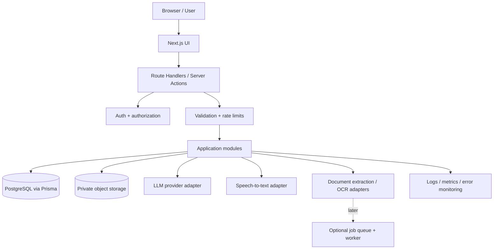
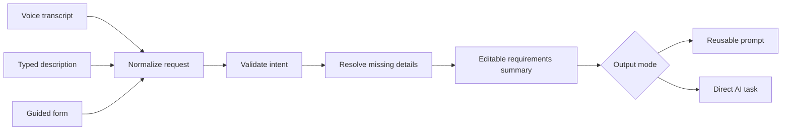

# System Architecture

## Adopted technology direction

The project is standardized on a modular Next.js App Router application using React, TypeScript, Node.js LTS, and npm. The public visual layer uses Tailwind CSS 4, shadcn/ui-compatible source components, Lucide React icons, and Motion where motion materially improves an interaction. React Hook Form and Zod are reserved for later complex, validated forms.

The application uses Route Handlers and server-side modules; there is no separate Express server. UI components, application services, database access, and provider adapters must remain separate. PostgreSQL on Neon, Prisma, and Better Auth are approved future-phase directions, not installed services. AI provider access will use the Vercel AI SDK behind replaceable server-only adapters. Browser speech recognition with typed fallback comes before any server transcription; private storage and document processing remain later work.

## Current implementation boundary

Phase 1 has a Next.js application shell and public homepage source. It has no database, authentication, provider integration, voice recognition, uploads, or server-side business services. Local sample prompt data is presentation-only and must not be treated as a production catalog.

## Default architecture

Use a modular monolith initially: one Next.js application containing the frontend and server-side API/modules, plus PostgreSQL and private object storage. Add workers, queues, dedicated search infrastructure or separate services only when measured requirements justify them.

## Application modules

- `catalog`: public prompt listing, prompt details, categories and tags.
- `search`: text search, filters and ranking.
- `voice`: browser feature detection, transcript state, transcription adapter.
- `intent`: parse natural language into a strict, validated intent object.
- `clarification`: track missing fields and questions asked during a session.
- `prompt-engine`: template selection, prompt assembly, placeholders and output quality checks.
- `ai-tasks`: direct tasks such as explaining notes, quiz generation and answer drafting.
- `documents`: upload authorization, file metadata, extraction, OCR, processing status and deletion.
- `workspace`: favorites, collections, history and versions.
- `community`: submissions, ratings and reports.
- `admin`: category/prompt management and moderation.
- `usage`: quotas, provider token usage and cost tracking.

## Trust boundaries

1. Browser input is untrusted.
2. Transcripts and extracted document text are untrusted.
3. Model output is untrusted until validated.
4. Only server code may use provider credentials.
5. Storage objects are private by default; access is checked against the authenticated user and signed URLs are short-lived.
6. Authorization must be enforced on every protected request, not only in the UI.

## Shared input pipeline

Voice, typed text and guided form input must converge on the same intent schema and prompt composer. Do not build a separate prompt-writing system only for voice.

## Reusable prompt versus direct task

- Reusable-prompt mode produces instructions to copy/save. It must not claim to have done the downstream task.
- Direct-task mode sends the user's task and authorized context to an integrated model and returns a result. It must display that AI execution is occurring and account for provider usage.
- Uploaded files do not magically travel with a copied prompt. Add a placeholder telling the user to attach the file in the destination tool, unless an explicit integration transfers it with authorization.

## Synchronous vs asynchronous work

For early MVP and small files, process requests synchronously with timeouts and clear status. For large files/OCR/long tasks, add a job table or queue with states such as `queued`, `processing`, `completed`, `failed`, and `cancelled`. Never pretend an unfinished job is completed.

## Scale-out triggers

Only consider added infrastructure when there is evidence: slow search may justify a search service; repeated expensive queries may justify caching; long-running extraction may justify a worker queue; sustained load may justify splitting services. Keep the provider adapters and module boundaries ready without deploying unused infrastructure.
