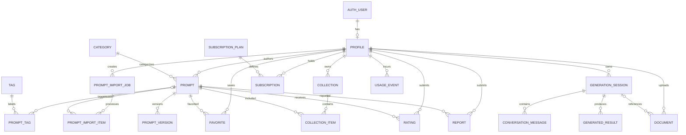

# Database Model Proposal — PROMPT/DEPT.

## 1. Purpose and architecture

This document defines the proposed logical database model for PROMPT/DEPT., a prompt discovery, management, and generation platform.

The platform must support:

- A searchable, image-first prompt gallery.
- Administrator-managed prompts and categories.
- Manual prompt creation and bulk imports from CSV, JSON, and supported GitHub repository files.
- User authentication, profiles, favorites, and collections.
- Draft, review, publication, and moderation workflows.
- Free and premium prompt access.
- Future subscription billing and usage limits.
- Prompt generation, conversation sessions, and optional document processing.

### Recommended technology

- **Database:** Supabase PostgreSQL.
- **Authentication:** Supabase Auth.
- **File storage:** Supabase Storage with private-by-default access where appropriate.
- **Authorization:** PostgreSQL Row Level Security (RLS), server-side permission checks, and trusted administrator role assignment.
- **Application integration:** Reuse the repository's existing framework and data-access conventions.
- **Schema management:** Version-controlled SQL migrations. Use Prisma only if it fits the existing repository and its Supabase integration; do not introduce a second competing schema-management system unnecessarily.

The logical model is independent of the final ORM. Adapt exact column types, foreign keys, and naming conventions to the existing codebase.

Do not migrate a production database without reviewed migrations, a backup, and a rollback plan.

---

## 2. Core entities

### 2.1 User and Profile

Supabase Auth manages authentication identities. Do not duplicate password hashes or build a separate password system.

**Profile fields:**
- `id`: UUID matching `auth.users.id`.
- `display_name`: Optional public display name.
- `avatar_url`: Optional avatar reference.
- `role`: `user` or `admin`, defaulting to `user`.
- `account_status`: `active`, `suspended`, or another explicitly defined status.
- `created_at`, `updated_at`.

**Rules:**
- Create a profile when a user registers, using a trusted database trigger or server-side process.
- Never allow users to promote themselves to administrator through profile updates.
- Restrict profile updates to permitted fields.
- Use Supabase Auth for credentials, email verification, password recovery, and OAuth.
- Keep private authentication metadata separate from public profile information.

### 2.2 Prompt

The `Prompt` entity is the primary content record for the platform.

**Core fields:**
- `id`: UUID primary key.
- `title`: Required human-readable title.
- `slug`: Unique URL-friendly identifier.
- `description`: Short summary for the gallery.
- `prompt_text`: Full reusable prompt content.
- `category_id`: Category reference.
- `author_id`: Nullable profile reference for system-curated prompts.
- `preview_image_url`: Optional image reference.
- `preview_image_storage_path`: Optional storage object key.
- `tags`: Prefer normalized tag relationships; use JSON only for supplemental metadata.
- `task_type`: Optional supported task or output type.
- `status`: `draft`, `pending_review`, `published`, `rejected`, or `archived`.
- `visibility`: `public` or `private`, where applicable.
- `access_tier`: `free` or `premium`.
- `is_featured`: Boolean, default false.
- `source_type`: `manual`, `csv_import`, `json_import`, `github_import`, or another controlled source.
- `source_url`: Original source URL when applicable.
- `source_repository`: Optional repository identifier.
- `source_license`: License identifier or recorded license information.
- `attribution`: Optional attribution text or creator reference.
- `content_hash`: Optional normalized content hash for duplicate detection.
- `published_at`: Nullable publication timestamp.
- `created_at`, `updated_at`.

**Rules:**
- Only published prompts that satisfy the public visibility and access policies appear in public gallery queries.
- A premium prompt must not expose its protected prompt text to unauthorized users through an API or direct database query.
- Do not publish imported content until it has passed validation, source/license review, and any required moderation.
- Keep source metadata for imported content.
- Enforce a unique slug and an appropriate uniqueness strategy for duplicate detection.
- Store image files in Supabase Storage or another configured asset store; keep references and metadata in PostgreSQL.
- Avoid deleting prompts that are referenced by user collections or historical records without an explicit deletion policy.

### 2.3 Category

Categories organize the public prompt gallery and admin workflows.

**Fields:**
- `id`.
- `name`.
- `slug`: Unique.
- `description`.
- `parent_category_id`: Nullable self-reference for nested categories.
- `display_order`.
- `is_active`.
- `created_at`, `updated_at`.

Initial categories may include Image Generation, Websites, 3D & Motion, Coding, Writing, Study & Exams, and Product Photography.

Categories must be manageable through the admin panel.

### 2.4 Tag and PromptTag

**Tag fields:**
- `id`.
- `name`.
- `slug`: Unique.
- `created_at`.

**PromptTag fields:**
- `prompt_id`.
- `tag_id`.

Add a unique constraint on `(prompt_id, tag_id)`.

Use tags for styles, tools, techniques, models, subjects, and other discovery metadata. Avoid storing all tags as an unvalidated comma-separated string.

### 2.5 PromptVersion

Stores revisions of prompt content where version history is enabled.

**Fields:**
- `id`.
- `prompt_id`.
- `version_number`.
- `title_snapshot`.
- `prompt_text_snapshot`.
- `change_summary`.
- `changed_by`: Nullable profile reference for automated changes.
- `created_at`.

Add a unique constraint on `(prompt_id, version_number)`.

Define whether every administrator edit creates a version or only explicitly versioned changes do. Keep published revision history separate from the current editable prompt record.

### 2.6 PromptImportJob

Tracks CSV, JSON, and GitHub import operations.

**Fields:**
- `id`.
- `created_by`: Administrator profile reference.
- `source_type`: `csv`, `json`, or `github`.
- `source_url`: Nullable validated source URL.
- `original_filename`: Optional display name.
- `storage_path`: Optional private temporary upload reference.
- `status`: `queued`, `processing`, `completed`, `completed_with_errors`, or `failed`.
- `total_records`.
- `valid_records`.
- `imported_records`.
- `duplicate_records`.
- `invalid_records`.
- `failed_records`.
- `error_summary`: Sanitized summary.
- `field_mapping`: Validated JSON mapping from source fields to prompt fields.
- `started_at`, `completed_at`.
- `created_at`, `updated_at`.

Do not store access tokens, secrets, or unrestricted raw file contents in ordinary job records.

### 2.7 PromptImportItem

Tracks the result of processing each record in an import job.

**Fields:**
- `id`.
- `import_job_id`.
- `row_number`: Nullable for non-tabular sources.
- `source_record_key`: Optional stable source identifier.
- `prompt_id`: Nullable reference to the resulting prompt.
- `status`: `valid`, `imported`, `duplicate`, `invalid`, or `failed`.
- `error_code`: Optional controlled error identifier.
- `error_message`: Sanitized, length-limited explanation.
- `created_at`, `updated_at`.

Use a unique source key or idempotency key where practical. This helps prevent accidental duplicate inserts when a job is retried.

**Import policy:**
1. Upload or retrieve a supported source.
2. Parse and validate the content.
3. Preview records and field mappings.
4. Detect duplicates and report invalid records.
5. Import eligible records as drafts by default.
6. Review attribution, licensing, and content quality.
7. Publish through an explicit administrator action.

Process large imports in batches. Validate external URLs and file types, restrict fetches to permitted GitHub hosts, and defend against server-side request forgery (SSRF). Do not execute imported content.

### 2.8 Favorite

Records user likes or favorites, depending on the product's chosen interaction model.

**Fields:**
- `user_id`.
- `prompt_id`.
- `created_at`.

Add a unique constraint on `(user_id, prompt_id)`.

If the interface distinguishes liking from bookmarking, use separate `PromptLike` and `SavedPrompt` tables instead of combining two distinct behaviors.

### 2.9 Collection and CollectionItem

Allow users to organize prompts into collections.

**Collection fields:**
- `id`.
- `owner_id`.
- `name`.
- `description`.
- `visibility`: `private` or `public`.
- `created_at`, `updated_at`.

**CollectionItem fields:**
- `collection_id`.
- `prompt_id`.
- `position`.
- `created_at`.

Add a unique constraint on `(collection_id, prompt_id)` and an index supporting collection ordering.

Only the owner may modify a private collection or its items. Public collections should be exposed only according to the selected visibility policy.

### 2.10 Rating and Report

**Rating fields:**
- `id`.
- `user_id`.
- `prompt_id`.
- `score`: Integer within a defined permitted range.
- `feedback`: Optional length-limited text.
- `created_at`, `updated_at`.

If each user may rate a prompt once, add a unique constraint on `(user_id, prompt_id)`.

**Report fields:**
- `id`.
- `reporter_id`.
- `prompt_id`.
- `reason`: Controlled enum or validated set of values.
- `details`: Optional length-limited text.
- `status`: `open`, `under_review`, `resolved`, or `dismissed`.
- `reviewed_by`: Nullable administrator reference.
- `reviewed_at`.
- `created_at`, `updated_at`.

Reports and moderation notes must be restricted to authorized users.

### 2.11 SubscriptionPlan and Subscription

Prepare the data model for future paid subscriptions without implementing payment processing prematurely.

**SubscriptionPlan fields:**
- `id`.
- `name`.
- `slug`: Unique.
- `description`.
- `price_amount`: Integer in the smallest currency unit.
- `currency`.
- `billing_interval`: `month`, `year`, or another explicitly supported interval.
- `is_active`.
- `entitlements`: Validated JSON for configurable feature limits.
- `created_at`, `updated_at`.

**Subscription fields:**
- `id`.
- `user_id`.
- `plan_id`.
- `billing_provider`: For example, Stripe or Razorpay.
- `provider_customer_id`.
- `provider_subscription_id`.
- `status`: `pending`, `active`, `past_due`, `cancelled`, `expired`, or another provider-mapped state.
- `current_period_start`.
- `current_period_end`.
- `cancel_at_period_end`.
- `created_at`, `updated_at`.

Store only necessary billing identifiers and subscription state. Do not store card numbers or sensitive payment credentials.

Enforce unique provider subscription identifiers where appropriate. Subscription status must be updated through verified server-side billing events or trusted reconciliation, not user-editable profile fields.

### 2.12 SubscriptionEvent

Optionally record provider webhook events for reliable processing.

**Fields:**
- `id`.
- `billing_provider`.
- `provider_event_id`: Unique per provider.
- `event_type`.
- `processing_status`.
- `processed_at`.
- `created_at`.

Use idempotent processing to prevent duplicate webhook delivery from granting duplicate entitlements or applying conflicting state changes.

### 2.13 UsageEvent

Tracks feature usage for quotas, diagnostics, and future billing enforcement.

**Fields:**
- `id`.
- `user_id`: Nullable for supported guest requests.
- `session_id`: Nullable generation session reference.
- `feature`: For example, prompt generation, document processing, or premium prompt access.
- `provider`.
- `model`.
- `input_units`, `output_units`: Nullable usage measures.
- `estimated_cost`: Optional monetary estimate.
- `status`.
- `request_id`: Unique request or idempotency identifier where appropriate.
- `created_at`.

Avoid storing API keys, provider secrets, raw private content, or unnecessary personal data in usage events.

### 2.14 GenerationSession

Tracks a prompt-generation workflow.

**Fields:**
- `id`.
- `owner_id`: Nullable only if guest sessions are supported.
- `input_mode`: `text`, `voice`, or another supported mode.
- `normalized_intent`: Validated JSON payload.
- `status`.
- `created_at`, `updated_at`.
- `expires_at`: Optional retention expiry.

Do not store raw audio by default. Persist transcripts or generation history only when the feature is disclosed to users and the retention policy permits it.

### 2.15 ConversationMessage

**Fields:**
- `id`.
- `session_id`.
- `role`: Controlled enum, such as `user`, `assistant`, or `system` where required by the application.
- `content`.
- `safe_metadata`: Optional validated JSON.
- `created_at`.

Enforce allowed roles, content length limits, session ownership, and retention/deletion rules. Do not persist provider internal reasoning.

### 2.16 Document

**Fields:**
- `id`.
- `owner_id`.
- `session_id`: Nullable.
- `storage_path`: Private object key.
- `original_filename`.
- `mime_type`.
- `size_bytes`.
- `processing_status`.
- `safe_error_code`.
- `extracted_text_reference`: Optional protected reference.
- `created_at`, `updated_at`.
- `expires_at`, `deleted_at`.

Never make private uploads public by default. Validate file size, content type, authorization, and retention requirements. Keep large file bytes outside ordinary relational rows.

### 2.17 GeneratedResult

**Fields:**
- `id`.
- `session_id`.
- `result_type`: For example, `reusable_prompt`, `direct_answer`, `summary`, or `quiz`.
- `content`.
- `provider`, `model`: Optional metadata.
- `usage_metadata`: Validated JSON where appropriate.
- `created_at`.

Persist private generated content only when history is enabled and disclosed to the user.

---

## 3. Relationship overview

`AUTH_USER` represents Supabase Auth's managed identity. Do not recreate the authentication identity table as an independently maintained application table.

---

## 4. Indexes and constraints

Consider these indexes and constraints:

- Unique prompt slug.
- Unique category and tag slugs.
- Unique `(prompt_id, tag_id)`.
- Unique `(user_id, prompt_id)` for favorites and ratings where applicable.
- Unique `(collection_id, prompt_id)`.
- Unique `(prompt_id, version_number)`.
- Unique provider subscription ID and provider event ID where applicable.
- Index prompts by publication status, category, access tier, and publication date.
- Index prompt search fields; use PostgreSQL full-text search for the initial implementation.
- Index import jobs by creator, status, and creation time.
- Index import items by job and status.
- Index documents by owner and processing status.
- Index generation sessions by owner and update time.
- Index subscriptions by user and status.
- Constrain allowed status values, access tiers, rating ranges, file sizes, and content lengths.
- Use foreign keys and transactions for multi-record operations.
- Define explicit deletion behavior for user accounts, prompts, collections, and historical records.
- Add pagination and stable ordering for large gallery queries.

Use JSONB only for flexible, validated metadata such as generation intent, entitlements, and source-specific payloads. Do not use a single JSON field as a substitute for core relational entities.

---

## 5. Security and authorization rules

### Public visitors
- Read published public prompts only.
- Access only content permitted by the relevant free/premium access policy.
- Never read draft, rejected, archived, or private prompt records through public endpoints.

### Authenticated users
- Manage their own profile fields that are user-editable.
- Create and manage their own collections.
- Add or remove their own favorites.
- Access only their own private generation history and documents.
- Never assign themselves an administrator role or subscription entitlement.

### Administrators
- Manage prompts, categories, tags, import jobs, moderation, and publication state.
- Access administrative operations only after server-side role verification.
- Have import and publication actions audited where appropriate.

### Subscription access
- Verify entitlement on the server for protected premium content and generation limits.
- Do not rely on hidden buttons, client-side flags, or local storage to enforce paid access.
- Validate billing webhooks and apply events idempotently.
- Do not store payment credentials.

### Supabase security
- Enable RLS on tables exposed through Supabase APIs.
- Use narrowly scoped policies for public reads, owner-only operations, and administrative actions.
- Keep service-role credentials on trusted servers only.
- Do not trust user-supplied role, billing status, or owner IDs without authorization checks.
- Review database triggers and security-definer functions for safe privileges and search paths.

---

## 6. Data-model and implementation rules

1. Inspect the existing repository and database before defining migrations.
2. Reuse existing entities and conventions where practical.
3. Keep authentication in Supabase Auth if Supabase is the selected solution.
4. Store prompt content and metadata in PostgreSQL; store image and document files in object storage.
5. Import external content as drafts by default.
6. Preserve source URLs, license information, and attribution for imported prompts.
7. Implement bulk import validation, duplicate detection, and retry-safe batch processing.
8. Do not expose premium prompt bodies through public queries or API responses.
9. Introduce subscription schema now if useful, but defer payment integration until required.
10. Version all SQL migrations and test them against a disposable development database.
11. Test RLS policies, administrator access, import failures, duplicate imports, and entitlement checks.
12. Define data retention, account deletion, and backup/restore procedures before production launch.

## 7. Recommended implementation order

**Phase 1 — Foundation**
- Supabase project and environment configuration.
- Authentication and profile creation.
- Roles and RLS policies.
- Core prompt, category, and tag schema.

**Phase 2 — Prompt administration**
- Admin dashboard.
- Manual prompt creation and editing.
- Draft, review, and publication workflow.
- Gallery integration and search.

**Phase 3 — Bulk imports**
- CSV and JSON upload.
- Preview, validation, and duplicate detection.
- Import history and error reporting.
- Supported GitHub file import.

**Phase 4 — User features**
- Favorites, likes, and collections.
- Prompt versions and reports.
- Private generation history where enabled.

**Phase 5 — Monetization readiness**
- Free/premium access tiers.
- Subscription plan and subscription records.
- Usage tracking and entitlement checks.
- Billing-provider integration only when subscriptions are launched.

Build the smallest complete vertical slice first: authenticate an administrator, create or bulk-import a prompt, approve and publish it, and confirm that it appears in the gallery with the correct access restrictions.
