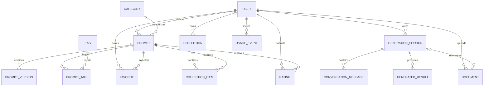

# Database Model Proposal

This document describes logical entities. The exact Prisma schema must be adapted to the repository's current state and authentication solution. Do not migrate a production database without a reviewed migration and backup plan.

## Core entities

### User
- `id`, unique normalized `email` or auth-provider identity, optional display name, role/status, created/updated timestamps.
- Store password hashes only if using password-based authentication directly; prefer a maintained authentication solution when appropriate.

### Prompt
- `id`, `title`, unique `slug`, short description, prompt body, category ID, author ID (nullable for system-curated prompts where appropriate), visibility (`public`/`private`), moderation/publication status, timestamps.
- Add fields for usage notes, placeholder schema, supported task type and prompt metadata only as required.

### Category and Tag
- Category has a name, slug, description and optional parent category.
- Tag has a name/slug. `PromptTag` joins prompts and tags with a unique `(promptId, tagId)` constraint.

### PromptVersion
- Prompt ID, version sequence, content snapshot, change summary, author ID, created timestamp.
- Keep version policy clear: either user-edited versions belong to a saved prompt or immutable revisions are separate records.

### GenerationSession
- Owner ID (nullable for temporary guest session only if guest mode is supported), input mode, normalized intent JSON, session status, created/updated timestamps, retention/expiry fields where appropriate.
- Avoid storing raw audio. Do not persist transcript/history unless the product's retention rules permit it.

### ConversationMessage
- Session ID, role enum, text content, safe metadata, timestamp.
- Enforce role allowlist. Consider retention/deletion and avoid storing provider internal reasoning.

### Document
- Owner ID, optional session ID, storage key, original display name, MIME type, size, processing status, safe error code, extracted text pointer or protected content, timestamps, expires/deleted state.
- Never make storage objects public by default.

### GeneratedResult
- Session ID, result type (`reusable_prompt`, `direct_answer`, `summary`, `quiz`, etc.), content, provider/model identifier if appropriate, usage metadata and timestamp.
- Avoid persisting private content unless history is enabled and disclosed.

### Favorite
- User ID + Prompt ID; unique pair constraint.

### Collection and CollectionItem
- User-owned collection metadata, visibility and timestamps. `CollectionItem` joins collection and prompt with unique pair and an ordering field.

### Rating and Report
- Rating: user, prompt, score constrained to permitted range, optional feedback and timestamp; unique user/prompt rating if selected policy requires it.
- Report: reporter, target prompt, reason enum, details with length limits, moderation state and timestamps.

### UsageEvent
- User/session, feature, provider, model, token/character/audio/file usage where relevant, estimated cost, status, timestamp and request ID. Do not store secrets.

## Relationship overview

## Indexes and constraints to consider

- Unique normalized email/auth identity.
- Unique public prompt slug.
- Index public prompts by publication status/category/updated date as needed.
- Index prompt search fields; consider PostgreSQL full-text index for the first version.
- Unique favorite `(userId, promptId)`.
- Unique collection item `(collectionId, promptId)` and ordering index.
- Index documents by owner/status and sessions by owner/updated timestamp.
- Constrain enums, rating range, message lengths and statuses.
- Use foreign keys and transactions for multi-record operations.

## Data-model rules

- Do not rely on JSON for core entities that need relational queries, uniqueness constraints or authorization.
- JSON is appropriate for a versioned/validated intent payload, not as a substitute for the entire schema.
- Never place large raw file bytes in ordinary relational rows for the proposed production architecture.
- Add schema migrations to version control and test migrations against disposable/dev databases first.
