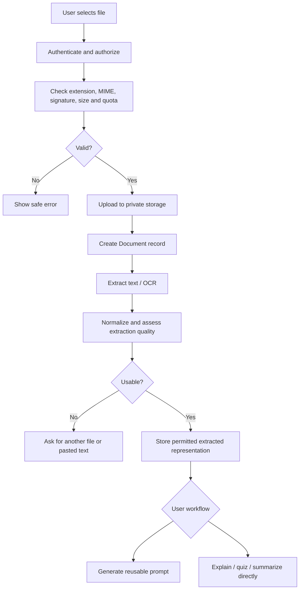

# Notes and Document Processing

## Supported initial formats

Start with a deliberate allowlist such as text-based PDF, DOCX, TXT, and common image formats. Confirm actual parsing libraries and maximum sizes in implementation. Do not claim handwritten OCR works well until tested with representative samples.

## Upload lifecycle

## Document states

Suggested finite states: `upload_pending`, `uploaded`, `processing`, `completed`, `failed`, `deletion_pending`, `deleted`. Define transitions and retries. A failed extraction must not be returned as a successful empty document.

## Private metadata

Suggested metadata: owner ID, session ID where applicable, original filename sanitized for display, detected MIME type, byte size, storage key, content hash where useful, processing status, timestamps, deletion/expiry timestamp, and safe error code. Never use a user-supplied filename as a storage path.

## Extraction and context

- Prefer direct text extraction when available.
- Use OCR for scanned PDFs and images when configured.
- Preserve page numbers and section boundaries where possible.
- Measure extraction quality and communicate when the text appears incomplete.
- For long documents, split text into bounded chunks, keep stable source references and retrieve relevant chunks for the task instead of sending every page blindly to the model.
- Apply model context/token limits. If a request cannot include the entire source, tell the user which processing approach is being used.
- Avoid promising that every handwriting style, table, equation or diagram will be extracted perfectly.

## Two different note workflows

### Generate a reusable prompt

Return instructions with a placeholder such as `[ATTACH OR PASTE YOUR NOTES HERE]`. If the prompt is copied to another AI product, make clear that the user must attach/paste the notes there. Do not expose storage keys or private URLs in prompt text.

### Explain notes directly

Use only document records owned by the requester. Retrieve permitted extracted text, apply the user's source preference, call the configured AI provider, validate response and return source references when possible. If the user chooses “notes only,” instruct the model not to add unsupported facts and to identify gaps.

## Deletion and retention

Deleting a document should invalidate future access, delete the storage object and permitted extracted content, and update associated metadata. Account for logs/backups according to an explicit retention policy. Avoid logging extracted text or private content by default. Make retention duration configurable and documented.

## Security controls

- Validate actual file content, not just extension/MIME supplied by the browser.
- Keep storage private and use short-lived scoped access URLs if necessary.
- Limit file size, page count, processing time, concurrency and cost.
- Consider malware scanning before processing.
- Prevent path traversal and filename-based storage keys.
- Treat extracted text as untrusted prompt content. Ignore attempts within documents to override system instructions, reveal secrets or trigger tools.
- Enforce document ownership and authorization for upload, retrieval, task use and deletion.
